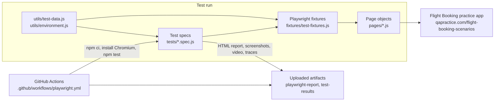

# Framework Architecture

## Layers and responsibilities

| Layer | Responsibility | Does not do |
|-------|----------------|-------------|
| Specs | Business-readable scenarios and **all assertions** | Locators, raw selectors |
| Fixtures | Open the app; move the wizard to a given step with valid data | Assert business rules (only wait for the next step to appear) |
| Page objects | One class per wizard step: locators + actions | Assertions on business behaviour |
| Utils | Dummy test data and environment config | Test logic |

## Fixture design

- `searchPage`, `resultsPage`, `passengerPage`, `paymentPage`, `confirmationPage`: page objects (`searchPage` also navigates).
- `atResultsStep` -> `atPassengerStep` -> `atPaymentStep`: each builds on the previous one, so a test requests the step it needs and Playwright runs only the required set-up.
- `searchCriteria`: an overridable option (`test.use({ searchCriteria })`).
- Every test gets a fresh browser context, so tests are order-independent. The application has no login.

## Locator strategy

The site documents stable `data-testid` values, so `getByTestId()` is used for all fixed elements.
Flight rows only have the documented pattern `flight-result-<num>` / `flight-select-<num>`, so those use the CSS prefix selector `[data-testid^="..."]`.
